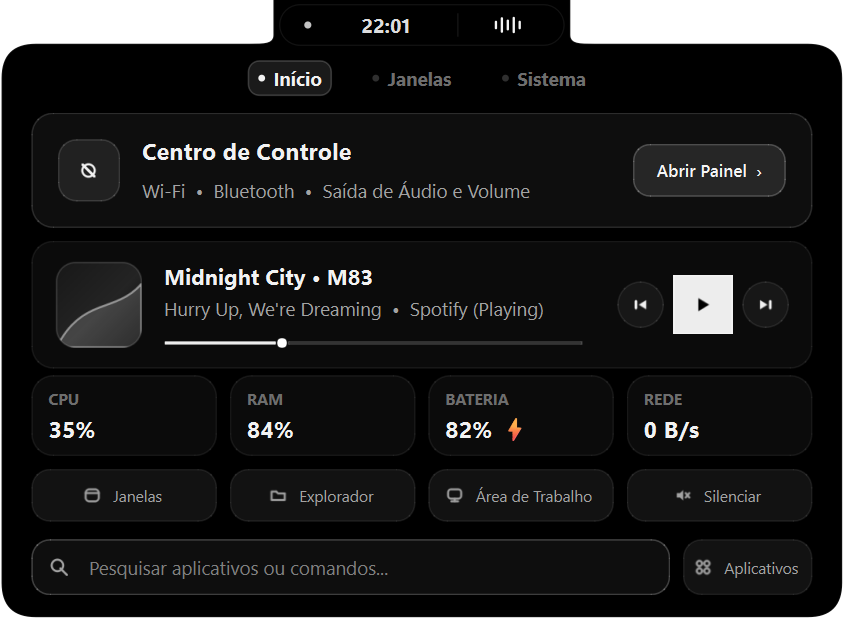
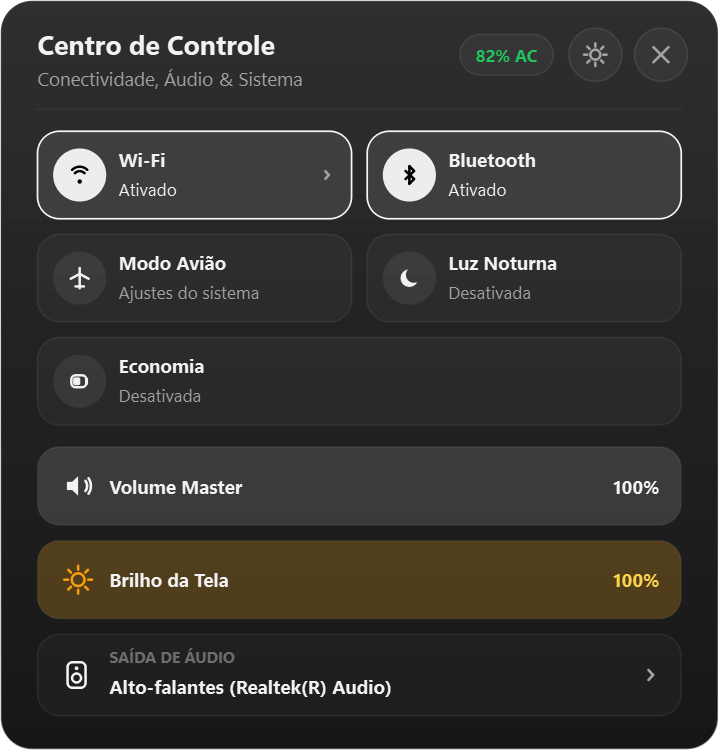
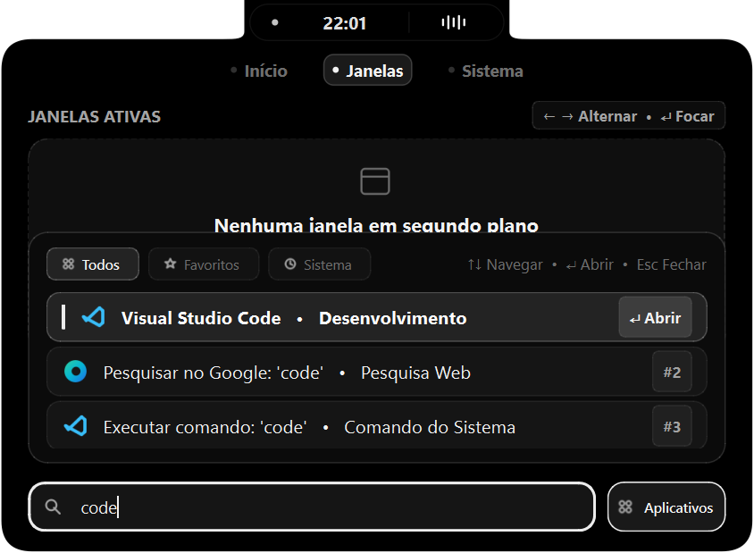
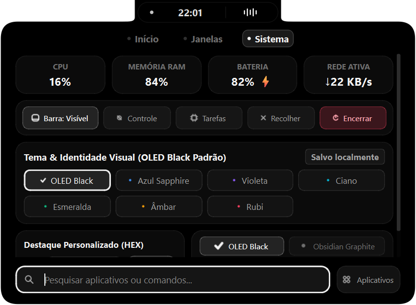

# Monolith

Uma ilha dinâmica feita para Windows 11 — escrita em Python com PyQt6, sem Electron nem WebView, focada em ficar quieta no topo da tela até você precisar dela.

A ideia nasceu de querer juntar num lugar só o que normalmente fica espalhado pela barra de tarefas: controle de mídia, alternância de janelas, busca rápida de apps e um Centro de Controle de verdade (Wi-Fi, Bluetooth, brilho, saída de áudio e volume), tudo com visual preto OLED que some na borda do monitor.

| Painel Principal & Mídia | Centro de Controle |
| :---: | :---: |
|  |  |

| Launcher Integrado | Sistema & Temas |
| :---: | :---: |
|  |  |

---

## O que ele faz

- **Cápsula discreta no topo:** Fica recolhida (`190x30`) centralizada na borda superior. Quando algum app está em tela cheia (jogo, vídeo, etc.), ela some sozinha para não atrapalhar. Com janela normal aberta, ela se recolhe parcialmente e desce quando você encosta o mouse no topo.
- **Mídia nativa do Windows (SMTC):** Detecta o que está tocando no Spotify, navegador ou qualquer player compatível com o Windows Media Session, com barra de progresso e controles.
- **Centro de Controle próprio:** Liga e desliga Wi-Fi e Bluetooth de verdade (via APIs WinRT/WLAN), troca dispositivo de saída de áudio (CoreAudio), ajusta volume master e brilho da tela, além de atalhos para Luz Noturna, Modo Avião e Economia de Energia.
- **Launcher sempre à mão:** Barra de busca fixa no rodapé do painel para abrir apps instalados, comandos ou jogar direto na busca da web.
- **Navegação fluida entre 3 páginas:** *Início*, *Janelas* (carrossel de janelas abertas) e *Sistema* (métricas de CPU/RAM/bateria/rede e personalização de cor de destaque).
- **Zero janela de terminal sobrando:** Abre desacoplado via `pythonw.exe` e garante instância única — se você abrir de novo, ele só ativa a janela que já está rodando.

---

## Como rodar

Você precisa de **Windows 10/11 (64-bit)** e **Python 3.11+** (testado em 3.12 e 3.13).

```bash
git clone https://github.com/PROTHOTYPE/dynamic-island-windows.git
cd dynamic-island-windows
pip install -r requirements.txt
```

Para abrir no dia a dia sem janela de terminal:
- Dê dois cliques em **`iniciar.bat`** (ou **`iniciar.vbs`**).

Se quiser rodar pelo terminal vendo os logs ao vivo (útil para debug):
```bash
python main.py --console
```

Os logs de execução ficam salvos automaticamente em `%LOCALAPPDATA%\Monolith\Logs\monolith.log`.

---

## Atalhos

| Atalho | O que faz |
| :--- | :--- |
| `Alt + Espaço` | Expande ou recolhe o painel principal |
| `Alt + C` | Abre ou fecha o Centro de Controle |
| `Esc` | Recolhe o painel ou fecha a busca |
| `←` / `→` | Alterna entre páginas (ou janelas no carrossel) |
| `↑` / `↓` e `Enter` | Navega e abre resultados no launcher |

Você também pode clicar direto na cápsula no topo da tela ou usar o ícone na bandeja do sistema (tray) para encerrar o app.

---

## Gerar executável (.exe)

Se quiser empacotar em uma pasta portátil com `Monolith.exe`, já existe um spec pronto do PyInstaller em `build/Monolith.spec`:

```bash
pip install -r requirements-build.txt
pyinstaller build/Monolith.spec
```

O resultado sai em `dist/Monolith/`.

---

## Por baixo do capô

- **Interface:** `PyQt6` com pintura customizada (`QPainter`), animações nativas e suporte a DPI fracionado (100%, 125%, 150%).
- **Integração Windows:** `pywin32`, `ctypes`, `comtypes` (CoreAudio) e `psutil`.
- **Workers assíncronos:** Scripts PowerShell isolados (`core/radio_worker.ps1` e `core/media_session_worker.ps1`) para conversar com as APIs WinRT de rádio e mídia sem travar a thread da UI.

```text
dynamic-island-windows/
├── main.py                  # Janela principal, ciclo de vida e atalhos globais
├── iniciar.bat              # Launcher padrão (desacoplado, aceita --console)
├── iniciar.vbs              # Launcher silencioso via WScript
├── core/                    # Adaptadores nativos (áudio, Wi-Fi, rádio, SMTC, visibilidade, logs)
├── ui/                      # Componentes visuais (SlidingPager, LauncherBar, ControlCenter, tema, ícones)
├── config/                  # Preferências de aparência salvas localmente
├── build/                   # Spec do PyInstaller, ícone e metadados de versão
├── tests/                   # Suíte de testes unitários e de integração
└── docs/screenshots/        # Capturas usadas neste README
```

---

## Testes

Para rodar os testes unitários e de UX (sem mexer no Wi-Fi/Bluetooth físico da máquina):

```bash
python -m unittest tests/test_unit_stabilization.py tests/test_ux_restructure.py
```

---

## Licença

MIT — veja o arquivo [LICENSE](LICENSE).
